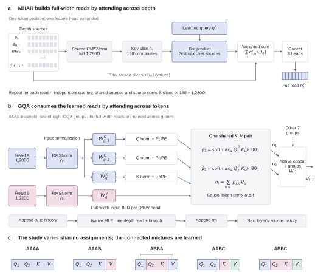

# Depth-Read Sharing in Grouped-Query Attention

Research code and numerical evidence for **Depth-Read Sharing in Grouped-Query
Attention**, by **Zimu Zhao** ([email](mailto:zimmer061310@gmail.com)).

**Question:** Which consumers within a GQA group should share a residual-depth
read when the reader is feature-adaptive MHAR?

[Manuscript source](paper/main.tex) · [Results](results/scores.csv) ·
[Reproduction](docs/REPRODUCTION.md) · [Data and release scope](docs/DATA.md)



## Main findings

Letters name shared reads in `(Q1,Q2,K,V)` order. The completed study has eight
patterns, three seeds (`2026, 613, 123`), and 24 independently trained models.
Nine checkpoints were evaluated on two sets, giving 33 endpoint scores.

| Pattern | Reads | Mean follow-up NLL ↓ | Difference from AAAA ↓ |
|---|---:|---:|---:|
| AAAA | 1 | 4.221317 | — |
| AAAB | 2 | 4.152995 | −0.068322 |
| ABAA | 2 | 4.213341 | −0.007977 |
| AABA | 2 | 4.179416 | −0.041901 |
| AABB | 2 | 4.206749 | −0.014568 |
| ABBA | 2 | 4.168289 | −0.053028 |
| AABC | 3 | 4.150502 | −0.070815 |
| ABBC | 3 | 4.154015 | −0.067302 |

All tested multi-read patterns have lower endpoint loss than AAAA in every
seed. Assignment matters at fixed read count. Neither three-read pattern
improves on AAAB in every seed; ABBC fails its original improvement criteria.

**Limits:** endpoints are 2,000 updates of a 20,000-update schedule. The four
additional two-read patterns use driver 580.76.05; references use 595.71.05.
The short driver bridge does not establish full-horizon equivalence. Three
seeds provide bounded replication, and seed 123 had prior engineering exposure.
These results do not establish MHAR's necessity or superiority over AttnRes.

## Verify the reported numbers

Python 3.10+ and its standard library are sufficient:

```sh
python scripts/verify_results.py
```

This checks every retained sequence-NLL aggregate, all 33 scores, checkpoint
reuse, paired means/SDs, and the original improvement decisions. It also checks
the release file manifest. It does not train or rescore a model.

## Inspect the models

Use the recorded PyTorch/Transformers versions in `requirements-model.txt`.
After installing them, run a reduced CPU fixture:

```sh
python scripts/model_smoke.py
```

The public `depth_read_sharing` entry point selects the original model classes
for all eight patterns. `reference/` preserves their source and dependency
files byte-for-byte, including historical internal filenames. It also contains
the training, data and checkpoint primitives. The fixture checks the packaged
model path; it is not production CUDA validation or a paper result.

## Repository layout

- `paper/`: manuscript, included tables, PDF figures and editable SVGs.
- `depth_read_sharing/`: small entry point for the eight evaluated patterns.
- `reference/`: frozen scientific implementation and configuration dependencies.
- `results/`: 33 curated score records, sequence NLL/counts and training summaries.
- `configs/study.json`: the reported model/training/evaluation specification.
- `scripts/`: saved-result verification and an explicitly reduced model fixture.
- `SOURCE-MAP.json`: original source and score-record identities.
- `MANIFEST.json`: checksums for this release snapshot.

## Availability and attribution

This is a publication candidate. Model weights and training/evaluation token
payloads are not included. See [data availability](docs/DATA.md) and
[attribution](NOTICE.md). Code retains the existing MIT license and upstream
copyright notice; no new license is assigned here to the manuscript or datasets.

Please use [CITATION.cff](CITATION.cff) when citing the software. No arXiv
identifier or publication venue has been assigned to this manuscript yet.
